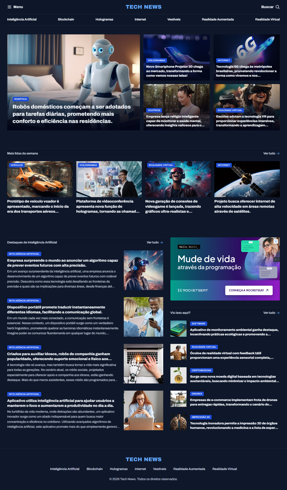
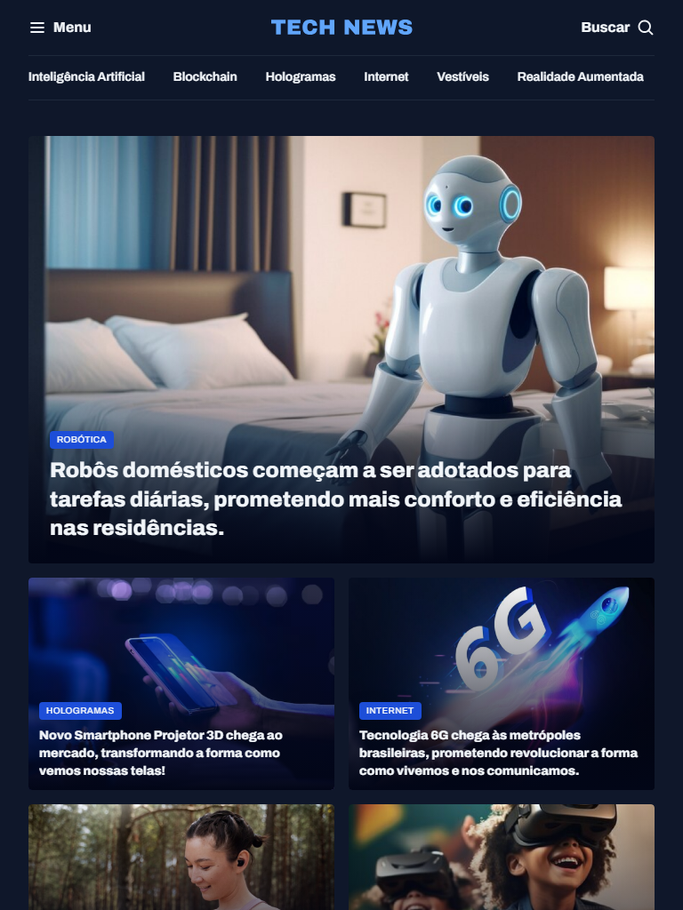
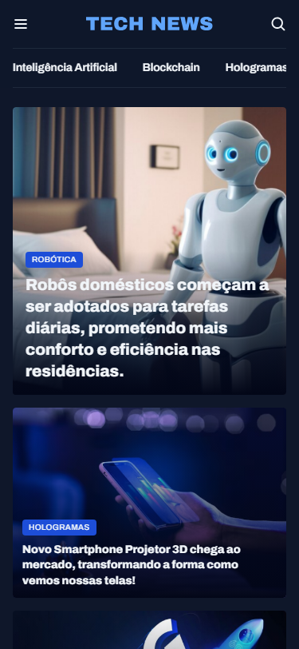

# Tech News

<p align="center">
  <strong>Portal de notícias de tecnologia responsivo, desenvolvido com HTML e CSS puros.</strong>
</p>

<p align="center">
  
  
  
  
  
</p>

<p align="center">
  <a href="https://montenegroengcomp.github.io/Portal-de-Noticias/"></a>
</p>

<p align="center">
  <a href="#demonstração-visual">Demonstração visual</a> •
  <a href="#funcionalidades">Funcionalidades</a> •
  <a href="#responsividade">Responsividade</a> •
  <a href="#tecnologias">Tecnologias</a> •
  <a href="#estrutura-de-pastas">Estrutura de pastas</a> •
  <a href="#pré-requisitos">Pré-requisitos</a> •
  <a href="#execução">Execução</a> •
  <a href="#decisões-técnicas">Decisões técnicas</a> •
  <a href="#validações-realizadas">Validações realizadas</a> •
  <a href="#autora">Autora</a>
</p>

---

Página inicial do **Tech News**, um portal de notícias sobre inteligência artificial, realidade virtual, internet, criptomoedas e outras tecnologias.

O projeto foi construído apenas com **HTML semântico** e **CSS**, sem frameworks nem JavaScript, com foco em CSS Grid, design tokens, CSS aninhado (nesting) e layout responsivo. O layout segue o modelo *Portal de notícias*, disponível na Figma Community.

🔗 **Acesse:** https://montenegroengcomp.github.io/Portal-de-Noticias/

## Demonstração visual

<p align="center">
  
</p>

<p align="center">
  
  &nbsp;
  
</p>

## Funcionalidades

### Cabeçalho

- Menu, logo e busca, com navegação secundária pelas categorias do portal.
- Fixo no topo durante a rolagem, com fundo semitransparente e desfoque (`backdrop-filter`).

### Destaques

- Notícia principal em tamanho grande e quatro notícias secundárias em grade 2 × 2.
- Título e etiqueta de categoria sobre a imagem, com degradê para garantir a leitura.

### Mais lidas da semana

- Quatro notícias com imagem, etiqueta de categoria e título limitado a três linhas.

### Destaques de Inteligência Artificial

- Lista de notícias com etiqueta, título, resumo limitado a quatro linhas e imagem quadrada.

### Coluna lateral

- Espaço de anúncio com botão de fechar.
- Lista **Viu isso aqui?** com miniaturas, categoria e título.

### Rodapé

- Logo, categorias do portal e copyright.

### Interações

- Cards inteiramente clicáveis, sem perder a semântica dos títulos.
- Zoom suave na imagem dos destaques e realce nas demais imagens ao passar o mouse.
- Títulos e links destacados na cor da marca no hover.
- Links **Ver tudo** com ícone de seta que muda de cor no hover.
- Animação de entrada das seções, desativada para quem prefere movimento reduzido (`prefers-reduced-motion`).

## Responsividade

O layout se adapta a três faixas de largura, com as media queries centralizadas em [`styles/responsive.css`](styles/responsive.css):

| Faixa | Cabeçalho | Destaques | Mais lidas | IA e coluna lateral |
| --- | --- | --- | --- | --- |
| Desktop (acima de 1024px) | Completo | Principal à esquerda, secundárias em 2 × 2 | 4 colunas | Lado a lado |
| Tablet (até 1024px) | Categorias com rolagem horizontal | Principal em largura total, secundárias em 2 × 2 | 2 colunas | Coluna lateral abaixo das notícias de IA |
| Celular (até 640px) | Apenas ícones de menu e busca | Uma coluna | 1 coluna | Uma coluna, sem os resumos e com imagens menores |

No desktop, com o container de 1280px, a página mantém as dimensões do layout original.

## Tecnologias

| Camada | Tecnologia | Versão |
| --- | --- | --- |
| Estrutura | HTML | 5 |
| Estilo | CSS (Custom Properties, Grid, Flexbox, nesting, media queries) | 3 |
| Tipografia | Google Fonts — Archivo | 400 a 800 |
| Ícones | SVG | — |

### Design tokens

As cores e estilos de texto ficam centralizados em variáveis no `:root` de [`styles/global.css`](styles/global.css):

| Token | Valor | Uso |
| --- | --- | --- |
| `--brand-color-light` | `#60A5FA` | Logo e hover dos links |
| `--brand-color-dark` | `#1D4ED8` | Etiquetas de categoria |
| `--bg-color` | `#0F172A` | Fundo da página |
| `--stroke-color` | `#1E293B` | Bordas e divisores |
| `--text-color-primary` | `#F1F5F9` | Títulos |
| `--text-color-secondary` | `#CBD5E1` | Textos de apoio |
| `--h1` | Archivo ExtraBold 24px / 135% | Título da notícia principal |
| `--h2` | Archivo ExtraBold 16px / 140% | Títulos das listas de notícias |
| `--h3` | Archivo ExtraBold 14px / 140% | Títulos menores |
| `--text-span` | Archivo SemiBold 14px / 145% | Navegação e títulos de seção |
| `--text` | Archivo Regular 16px / 140% | Texto base |
| `--text-small` | Archivo Regular 14px / 160% | Resumos das notícias |
| `--text-tag` | Archivo Medium 10px / 12px | Etiquetas de categoria |

## Estrutura de pastas

```text
.
├── assets/
│   ├── icons/              # Ícones SVG (menu, busca, setas e fechar)
│   ├── images/             # Imagens das notícias e do anúncio
│   └── logo.svg
├── docs/                   # Capturas de tela usadas no README
├── styles/
│   ├── index.css           # Ponto de entrada: importa os demais arquivos
│   ├── global.css          # Reset, design tokens e animação de entrada
│   ├── header.css          # Cabeçalho e navegação
│   ├── utility.css         # Classes utilitárias (grid, gap e line-clamp)
│   ├── sections.css        # Seções de notícias e coluna lateral
│   ├── footer.css          # Rodapé
│   └── responsive.css      # Media queries de tablet e celular
└── index.html
```

## Pré-requisitos

- Um navegador atualizado (Chrome, Edge, Firefox ou Safari)
- [Git](https://git-scm.com/), para clonar o repositório
- [VS Code](https://code.visualstudio.com/) com a extensão [Live Server](https://marketplace.visualstudio.com/items?itemName=ritwickdey.LiveServer) (opcional)

O projeto não tem dependências nem etapa de build.

## Execução

O projeto está publicado no GitHub Pages: https://montenegroengcomp.github.io/Portal-de-Noticias/

Para executar localmente, clone o repositório:

```bash
git clone https://github.com/MontenegroEngComp/Portal-de-Noticias.git
cd Portal-de-Noticias
```

Depois, escolha uma das opções:

- Abra o arquivo `index.html` diretamente no navegador; ou
- No VS Code, clique com o botão direito em `index.html` e selecione **Open with Live Server**, para recarregar a página automaticamente a cada alteração.

## Decisões técnicas

- **Design tokens em Custom Properties**: cores e tipografia são definidas uma única vez no `:root`, e o restante do CSS só referencia as variáveis.
- **Shorthand `font` em variáveis**: cada estilo de texto (peso, tamanho, altura de linha e família) é guardado em uma única variável, como `--h1: 800 24px/135% var(--font-family)`.
- **CSS modular e aninhado**: um arquivo por parte da página, todos importados por [`styles/index.css`](styles/index.css), com os seletores organizados por seção usando CSS nesting nativo.
- **Classes utilitárias**: `grid`, `grid-cols-*`, `gap-*` e `line-clamp-*` reaproveitam padrões de layout e de corte de texto entre as seções.
- **Corte de texto com `line-clamp`**: títulos e resumos são limitados a um número fixo de linhas com reticências, mantendo os cards alinhados independentemente do tamanho do texto.
- **Cards clicáveis com link expandido**: o link fica no título, e um `::after` posicionado sobre o card torna toda a área clicável, sem envolver o card inteiro em um `<a>`.
- **Imagens sem distorção**: `object-fit: cover` mantém as proporções das imagens em qualquer tamanho de card.
- **Grid sem estouro no mobile**: `minmax(0, 1fr)` impede que a largura natural das imagens force rolagem horizontal em telas pequenas.
- **Acessibilidade**: HTML semântico (`header`, `nav`, `main`, `section`, `article`, `aside` e `footer`), textos alternativos descritivos em todas as imagens, botão de fechar com `aria-label` e respeito a `prefers-reduced-motion`.

## Validações realizadas

| Validação | Resultado |
| --- | --- |
| Comparação com o layout do Figma em 1280px | Seções, espaçamentos, tipografia e cores conforme o modelo |
| Renderização em 1280px (desktop) | Destaques em grade, mais lidas em 4 colunas e coluna lateral ao lado das notícias de IA |
| Renderização em 768px (tablet) | Destaque principal em largura total, mais lidas em 2 colunas e coluna lateral abaixo |
| Renderização em 375px (celular) | Sem rolagem horizontal; cabeçalho compacto e conteúdo em uma coluna |
| Header fixo durante a rolagem | Conteúdo passa por baixo do cabeçalho sem sobreposição visível |

## Autora

**Clarisse Maria Cabral Montenegro**
